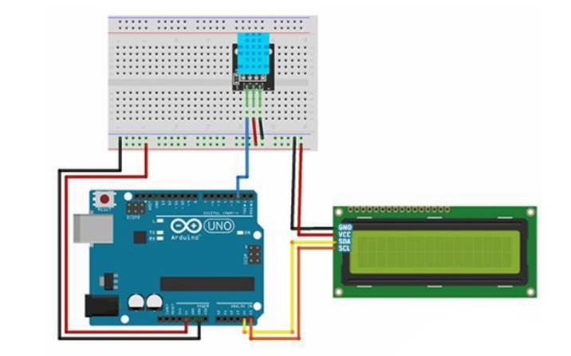

# Autonomous Microclimate Monitor

An embedded environmental monitoring system based on Arduino Uno, featuring real-time temperature and humidity tracking via the DHT11 digital sensor and an I2C-driven LCD display (16x2).

## Key Features

- **Real-Time Telemetry:** Continuous temperature and relative humidity measurement with a 2-second update interval.
- **Dynamic Extrema Tracking:** Automatically logs and computes session minimum and maximum values in-memory.
- **Optimized Bus Utilization:** Leverages the I2C protocol for LCD driving, minimizing GPIO pin footprint down to 3 signal lines.
- **Non-blocking Loop:** Utilizes `millis()` timing ticks instead of blocking `delay()` calls for responsive telemetry.
- **Fail-Safe Operation:** Runtime data validation (`isnan()` checks) and informative diagnostic display upon hardware disconnects.

## Hardware Components

| Component | Interface / Pin | Description |
| :--- | :--- | :--- |
| **Arduino Uno** | ATmega328P MCU | Core controller board |
| **DHT11 Sensor** | GPIO D2 | Digital temperature & humidity sensor |
| **LCD 1602 Display** | I2C (SDA -> A4, SCL -> A5) | Telemetry output screen |
| **Pull-up Resistor** | 10k Ohm | Between VCC and DATA line of DHT11 |

## Wiring & Schematics



## Software Stack & Dependencies

- **Language:** C++ / Embedded C
- **Framework:** Arduino Core
- **Required Libraries:**
  - `Wire.h` (Built-in I2C protocol library)
  - `LiquidCrystal_I2C` by Frank de Brabander
  - `DHT sensor library` by Adafruit
  - `Adafruit Unified Sensor`

## How to Build & Flash

1. Clone this repository:
   ```bash
   git clone https://github.com/arsqwertyy/arduino-environment-tracker.git
   ```
2. Open `src/main.ino` in **Arduino IDE** or **PlatformIO**.
3. Install the required libraries via Arduino Library Manager.
4. Select `Arduino Uno` under **Tools -> Board**.
5. Compile and upload to your board.

## License

This project is licensed under the MIT License - see the [LICENSE](LICENSE) file for details.
